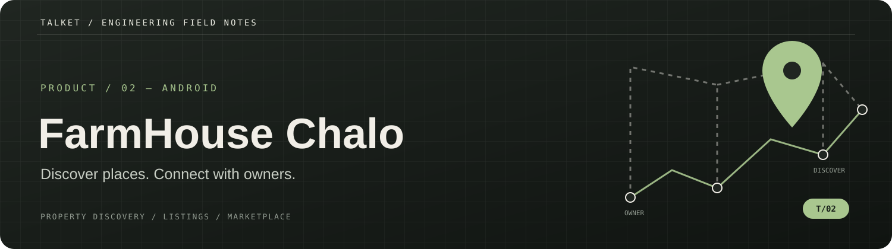
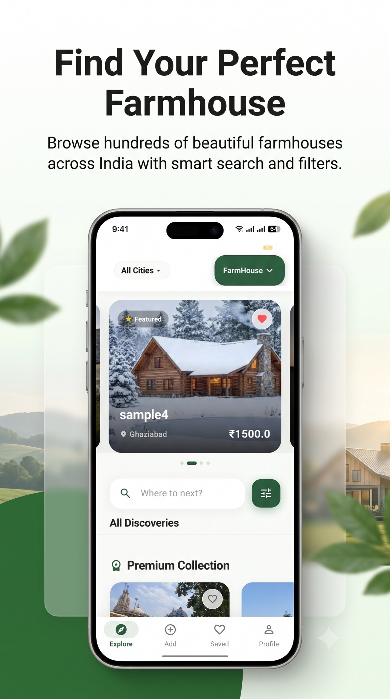
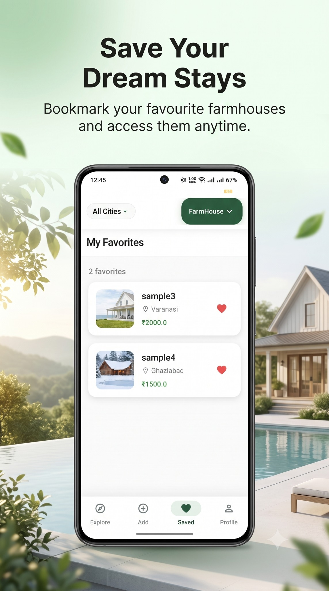
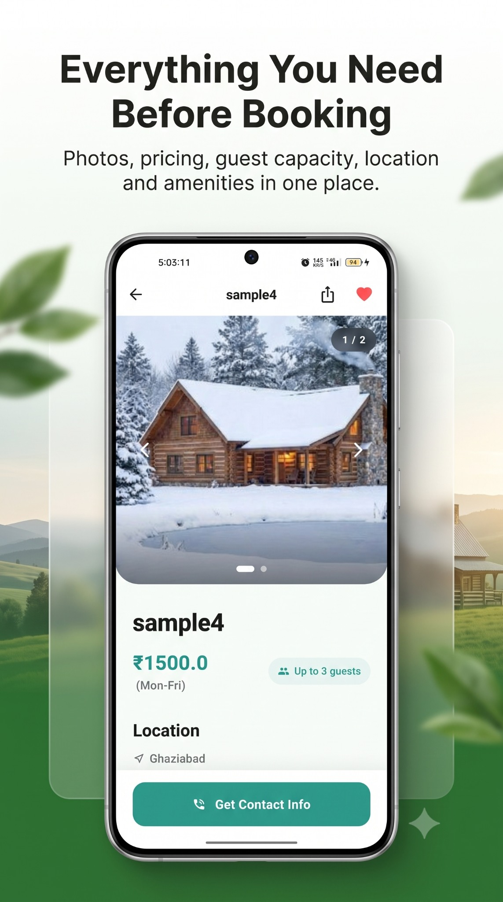
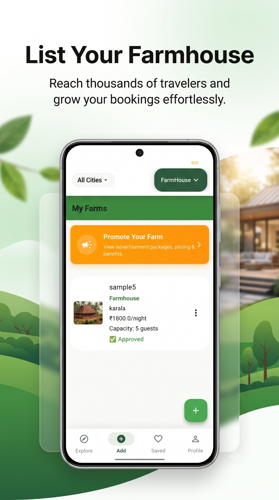
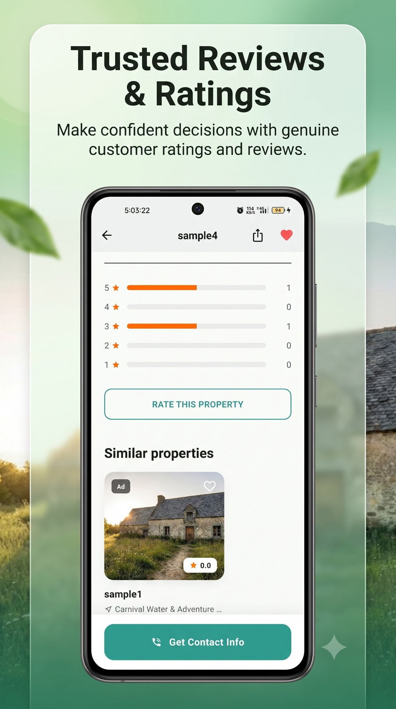
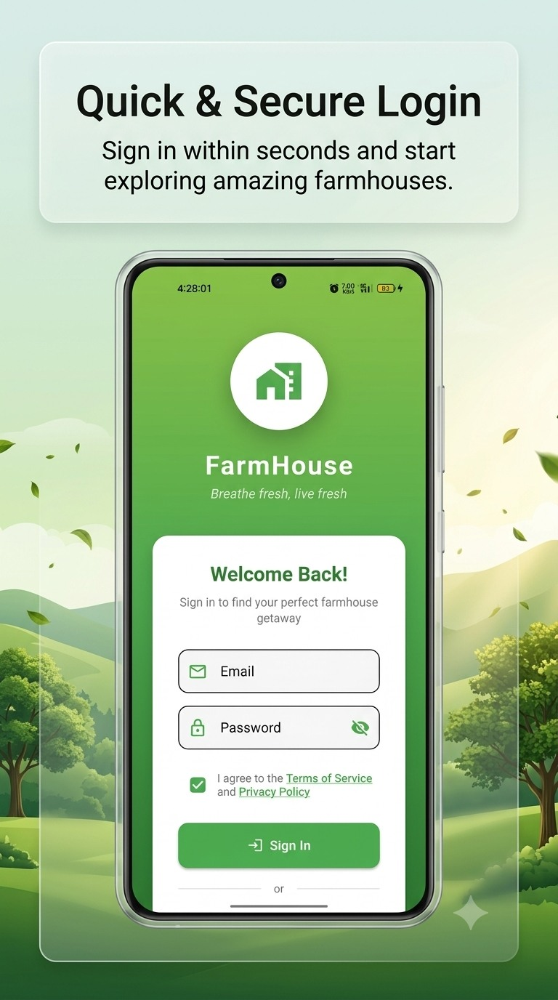
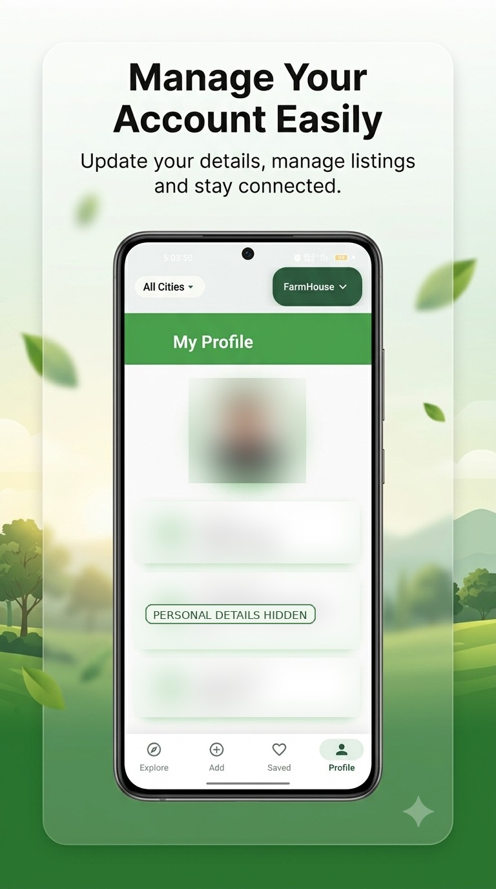
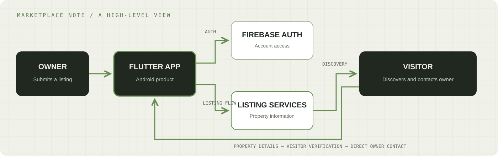

<p align="center">
  
</p>

<p align="center">
  
</p>

<p align="center">
  <a href="https://play.google.com/store/apps/details?id=com.farmhouse.app&amp;pcampaignid=web_share">
    
  </a>
</p>

<p align="center">
  <sub>Opens the FarmHouse Booking app listing on Google Play · Android product showcase · Source code not published here</sub>
</p>

> Package ID: `com.farmhouse.app`.

---

## 00 / The product

**FarmHouse Booking** is an Android marketplace-style product that connects farmhouse owners with people looking to discover farmhouse properties.

The product has two sides: owners can present a property through a listing, while visitors can explore available information—such as location, images, pricing, amenities, rules and availability—and contact the owner to make arrangements.

> **The product idea:** make farmhouse discovery more organized by bringing property information and owner discovery into one mobile experience.

## 01 / Product at a glance

| | |
|---|---|
| **Product** | FarmHouse Booking |
| **Category** | Travel / Local discovery / Marketplace |
| **Platform** | Android |
| **Mobile technology** | Flutter / Dart |
| **Authentication** | Firebase Authentication |
| **Location experience** | Permission-based location access, maps and directions |
| **Monetization integration** | Google AdMob, as described in the public policy |
| **Distribution** | Direct Google Play listing above |

## 02 / Two sides of the marketplace

### For visitors

- Discover farmhouse listings.
- Review property photos and descriptions.
- Compare location, pricing, amenities, rules and availability information.
- Use location-related functionality when permission is granted.
- Save favourite properties and review rating information as represented in the supplied product artwork.
- Contact the owner and verify property details before making arrangements.

### For property owners

- Create an account.
- Submit farmhouse listing information.
- Provide address and location details, photographs, pricing, amenities, rules and availability.
- Manage submitted listings and review listing status.
- Explore promotional options presented in the product artwork.

The published terms describe FarmHouse Booking as a platform for discovery and communication. Unless the app explicitly states otherwise, booking discussions, payments, cancellations and agreements are handled directly between visitors and farmhouse owners. This showcase does **not** claim that the app guarantees bookings or processes every payment in-app.

## 03 / Product gallery

The gallery below contains the FarmHouse Booking promotional product visuals supplied for this showcase. They communicate the app's visual direction and key journeys: property discovery, property details, favourites, owner listing management, reviews and account access.

<table>
  <tr>
    <td align="center" width="33%"><strong>01 · Discover farmhouses</strong><br/><br/><sub>Browse listings and explore properties</sub></td>
    <td align="center" width="33%"><strong>02 · Favourite stays</strong><br/><br/><sub>Save properties for later</sub></td>
    <td align="center" width="33%"><strong>03 · Property details</strong><br/><br/><sub>Review photos, price, capacity and location</sub></td>
  </tr>
  <tr>
    <td align="center" width="33%"><strong>04 · Owner dashboard</strong><br/><br/><sub>Manage submitted farmhouse listings</sub></td>
    <td align="center" width="33%"><strong>05 · Ratings and reviews</strong><br/><br/><sub>Property review experience</sub></td>
    <td align="center" width="33%"><strong>06 · Secure sign-in</strong><br/><br/><sub>Account access screen</sub></td>
  </tr>
</table>

<p align="center">
  <strong>07 · Account and profile</strong><br/>
  <br/>
  <sub>Profile-management visual; portrait and personal account fields have been blurred for public sharing.</sub>
</p>

> **Visual accuracy note:** These are supplied promotional compositions, not untouched device screenshots. The sample property names, locations, prices, ratings and review counts shown in the artwork are illustrative placeholders. They should not be interpreted as proof of real listings, verified reviews, bookings or customer activity. The profile image has been redacted to avoid publishing personal account details.

## 04 / How the product fits together

<p align="center">
  
</p>

The flow is intentionally shown at product level: owners submit property information, visitors discover and review listings, then contact owners to arrange details. The public documentation identifies Firebase Authentication and optional location access. This diagram is not a database schema or a complete production deployment diagram.

See [`docs/TECHNICAL_OVERVIEW.md`](docs/TECHNICAL_OVERVIEW.md) for product boundaries, public documentation and privacy notes.

## 05 / Engineering focus

### Two-sided product design

A marketplace has to serve two different user journeys. Owners need a clear way to submit useful information; visitors need enough context to decide whether a property is relevant before contacting its owner.

### Location and listing quality

Property discovery depends on accurate location and listing details. Location permission should be requested only when a feature needs it, and the product should remain clear about how location is used.

### Trust and operational boundaries

The public terms place responsibility for accurate listing information on owners and recommend that visitors verify property details before paying. The app's role should be communicated clearly: discovery and communication are not the same as inspection, verification or a guaranteed booking.

## 06 / Public product documentation

The existing [`farmhouse_booking`](https://github.com/Talket/farmhouse_booking) repository is a **legal-documentation repository**, not the mobile application's source repository:

- [Privacy policy](https://github.com/Talket/farmhouse_booking/blob/main/privacy-policy.html)
- [Terms and conditions](https://github.com/Talket/farmhouse_booking/blob/main/terms-and-conditions.html)

## 07 / Repository contents

```text
.
├── README.md
├── assets/
│   ├── app-icon.png
│   ├── header.svg
│   ├── architecture.svg
│   └── google-play-cta.svg
├── docs/
│   └── TECHNICAL_OVERVIEW.md
└── screenshots/
    ├── 01-discover-farmhouses.jpg
    ├── 02-favourite-stays.jpg
    ├── 03-property-details.jpg
    ├── 04-owner-dashboard.jpg
    ├── 05-ratings-and-reviews.jpg
    ├── 06-secure-sign-in.jpg
    ├── 07-account-profile-redacted.jpg
    └── README.md
```

**Application source code is not included.** Do not add signing keys, Firebase service credentials, API tokens, private endpoints, production data, customer details or private property information.

## 08 / Screenshot and privacy checklist

Before adding more visuals:

- Remove names, phone numbers, email addresses and account identifiers belonging to real users.
- Hide precise coordinates or private addresses unless they are intentionally public property-listing information and you have permission to show them.
- Do not expose private owner contact details, internal moderation views or unpublished listings.
- Remove notifications and unrelated apps from the status bar where practical.
- Label mockups and promotional art as such; do not present them as raw production screenshots.

## 09 / Links

<p align="center">
  <a href="https://play.google.com/store/apps/details?id=com.farmhouse.app&amp;pcampaignid=web_share">
    
  </a>
  <br />
</p>

- **Privacy policy:** [Read the policy](https://github.com/Talket/farmhouse_booking/blob/main/privacy-policy.html)
- **Terms:** [Read the terms](https://github.com/Talket/farmhouse_booking/blob/main/terms-and-conditions.html)
- **Developer portfolio:** [Talket / Portfolio](https://github.com/Talket/Portfolio)
- **Developer profile:** [github.com/Talket](https://github.com/Talket)

---

<p align="center">
  <sub>ENGINEERING FIELD NOTES / PRODUCT 02</sub><br />
  <strong>Better property discovery starts with better information.</strong>
</p>
